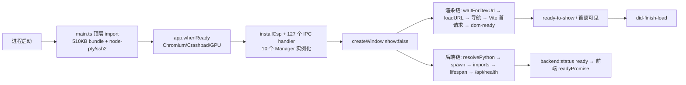

# 启动性能分析与生产上线方案

日期：2026-11-14 ｜ 适用版本：cKunAgentSSH 0.1.0 ｜ 分析样本：`npm run dev`（冷态，09:52:27.866 起算）

---

## 0. 结论先行

1. **这次 29.1s 的启动，关键路径是渲染链，不是后端链。** 主进程在 `@8627ms` 建窗后，渲染层与 Python 后端并行启动；后端 `@20127ms` 健康就绪，渲染层 `@28907ms` 才 `dom-ready`，慢的那条决定总时长。
2. **渲染链里最反常的 13.3s 是 dev 形态特有的。** 从 `did-start-navigation @12874ms` 到渲染进程打印 `[vite] connecting`（约 `@26218ms`）之间没有任何前端代码在执行；而连上 Vite 之后到 `dom-ready` 只用了 2.1s。也就是说前端模块编译不慢，慢在**首个 HTTP 请求排到 Vite transform 队列之后**。生产包走 `loadFile` 读本地文件，不经过 Vite dev server、不连 5555 端口，这段天然不存在。
3. **全链路按 5~68 倍等比放大，主因是环境不是代码。** 对照仓库内 `dev-server.log` 的热态剖面，主进程入口 7.8x、`whenReady` 19.6x、IPC 装配 67.8x、Python `imports` 6.6x、`init_db` 25x，没有任何单点能单独用代码逻辑解释；同一份代码热态时分别是 131ms / 199ms / 34ms / 888ms / 73ms。这符合**冷页缓存 + 安全软件实时扫描每个新加载的 DLL/.pyc/.js/.db 文件**的特征。日志里 `Failed to create GLES3 context, fallback to GLES2` 也说明 GPU 进程在反复重试上下文创建。
4. **一个被实测推翻的假设，写在这里避免误导后续排查。** 最初怀疑 `imports=5864ms` 是字节码缓存缺失（项目注释里有"无 .pyc 5240ms / 有 .pyc 430ms"）。用 `scripts/bench-imports.py` 做了非破坏性冷态对照：把 `backend/` 源码复制到不含 `__pycache__` 的临时目录后导入，**热态 973ms → 冷态 1146ms，只差 174ms（1.2x）**。因此字节码只是卫生项，不是这 5 秒的来源；那 5 秒属于整机冷 I/O 放大，且很可能包含 site-packages 侧的文件读取成本。
5. **"部署上线"对这个仓库不是网站发布。** 它是 Electron 桌面应用（Windows-only、tar.gz 解包直发），服务端只有本机回环的 Python 后端。对应的生产动作是：生产构建 → 内嵌 Python 运行时 → electron-builder 出包 → 签名/校验 → 分发与更新源。另有两件独立的"上线"：`gateway/` 内网 TLS 中转、`scripts/deploy/` 在远端 Linux 主机部署最小权限 Agent 账户。三者不要混为一谈。
6. **已落地并验证**：dev 首请求预热时序修复、warmup 精简与 A/B 开关、开发态字节码补齐工具、两个量化测量脚本；`npm run build` 生产构建通过（main / preload / renderer 三端齐全，`BUILD_EXIT=0`，1626 模块，渲染层构建 1m40s），`npm run typecheck` 通过（`TYPECHECK_EXIT=0`）。
7. **完整出件未在本会话完成**：`npm run package` 三次尝试都被工具会话 / 本机安全策略拦住，根因已定位为「内嵌 `runtime/python.exe` 进程被限制在 `backend/` 下写 `.pyc`」，与项目代码无关（详见 §5.7）。发布物需你在自己的真实终端执行同一条命令产出；本会话已把发布链路的每一前置步骤验证到位。
8. **重启实测（2026-11-14 10:41~10:53）**：关掉旧进程后用系统 node 重启，稳定热态 `did-finish-load` 为 **8.1s / 8.0s**（原冷态 29.1s，约 3.6x）；第一次重启 28.7s 是改过 vite 配置触发 `Re-optimizing dependencies` 的一次性成本。**随后做了一次证伪实验**：把 6s 兜底亮窗收紧到 300ms，结果反而 22.9s（同条件 6000ms 对照 11.0s）——「窗口 show 触发渲染层加载」只是两次巧合的相关性，不是因果，改动已回退，默认值仍是 6000。详见 §7.5。可确认的只有：冷 I/O 放大随热态消失；**剩余波动来自 Vite dev server 首个模块请求的排队（1.5~20s 不稳），不在客户端显示策略**。预热的独立贡献同样未隔离，不要凭这轮数据邀功。

9. **生产加载路径实测（2026-11-14 19:38~19:41）**：不注入 `ELECTRON_RENDERER_URL` 时，`electron/main.ts:356` 会走 `loadFile(out/renderer/index.html)`，即使未打包也一样。同一份代码、同样的 387 个前端文件 / 152 个后端 py / 1626 个构建模块，实测 `did-finish-load` **1291ms / 617ms**、`window ready-to-show` 1100ms / 545ms，无 6s 兜底、无 Vite dev server。**「项目功能太多导致启动慢」被数据否定**：慢的是 dev 的按需 transform，不是运行这些功能。已固化为 `npm run start:prod`，详见 §7.6。

---

## 1. 启动流程与关键路径

### 1.1 三条链



`createWindow()` 内 dev 分支用独立 async IIFE 发起 `waitForDevUrl` + `loadURL`，后端 `backendManager.start()` 在 `app.whenReady().then` 里 await —— **两条链确实是并行的**，不存在"后端没起来就阻塞窗口"的串行等待。这一点容易被日志的先后打印顺序误读。

### 1.2 冷态时间轴（本次样本）

| 绝对时刻 | 相对 T0 | 事件 |
| --- | --- | --- |
| 09:52:27.866 | 0 | 进程启动（由 `main module loaded @1028ms` 反推） |
| 09:52:28.894 | 1028 | main module loaded |
| 09:52:32.799 | 4933 | whenReady resolved |
| 09:52:35.105 | 7238 | ipc setup done |
| 09:52:36.493 | 8627 | createWindow returned |
| 09:52:37.041 | 9175 | Python spawned（解释器缓存命中 conda 3.13.12） |
| 09:52:38.645 | 10779 | dev server probe done |
| 09:52:40.740 | 12874 | renderer did-start-navigation |
| 09:52:41.598 | 13732 | orphan enumeration done（异步，不阻塞） |
| 09:52:42.510 | ~14644 | 6s 兜底 show：**窗口亮了但加载未完成** |
| 09:52:47.424 | ~19558 | GPU GLES3 失败 → GLES2 回退（两次） |
| 09:52:47.993 | 20127 | backend health ready |
| 09:52:49~52 | ~21300~25000 | WS bridge 建连 + 两个 botpy 渠道登录（后台线程，不阻塞 health） |
| 09:52:54.084 | ~26218 | [vite] connecting |
| 09:52:54.668 | ~26802 | [vite] connected |
| 09:52:56.773 | 28907 | dom-ready |
| 09:52:56.900 | 29034 | window ready-to-show |
| 09:52:56.998 | 29132 | did-finish-load |

**日志墙钟不可直接当发生时刻**：Python 后端 stdout 经管道批量刷出，`init_db` 行自带时间戳 09:52:44，却由主进程在 09:52:47.065 才打印（约 3s 延迟）。跨进程对表只认 `[perf] @Nms` 与 Python 自报的 `total=`，不要拿 `[HH:MM:SS]` 前缀去减。

### 1.3 冷/热态分段对比

用 `node scripts/profile-startup.mjs docs/startup-baseline-cold.log --baseline dev-server.log` 复现：

| 阶段 | 本次 | 热态基线 | 倍数 |
| --- | ---: | ---: | ---: |
| 主进程入口加载 | 1028ms | 131ms | 7.8x |
| Electron 初始化 whenReady | 3905ms | 199ms | 19.6x |
| IPC / Manager 装配 | 2305ms | 34ms | 67.8x |
| BrowserWindow 创建 | 1389ms | 112ms | 12.4x |
| 解释器解析 → Python spawn | 548ms | 326ms | 1.7x |
| dev server 探活 | 1604ms | 302ms | 5.3x |
| 探活完成 → 首次导航 | 2095ms | 10ms | 209.5x |
| 导航 → DOM 就绪 | 16033ms | 36859ms | 0.4x |
| Python 后端就绪 | 10952ms | 1458ms | 7.5x |
| 端到端 首窗可见 | 29034ms | 37975ms | 0.8x |
| 端到端 加载完成 | 29132ms | 37977ms | 0.8x |

Python 自报：`imports 5864ms / assemble 69ms / boot 42ms / lifespan 3277ms / total 9252ms`，其中 `init_db 1820ms`、`round1 1156ms`、`background 300ms`；热态对应 `888 / 49 / 65 / 117 / 1121`，`init_db 73ms`、`round1 42ms`、`background 2ms`。

注意热态那份日志的 `导航 → DOM 就绪` 是 36.9s，比本次还差 —— 那是 `electron.vite.config.ts` 注释里记录过的 chokidar 开局扫描 `runtime/`(8.9k 文件) 与 `.mimosa`(16.9k 文件) 导致首个请求排队；`rendererWatchIgnored` 白名单已修掉那一档。本次剩下的 13.3s 空档是**另一层**排队，见下节。

---

## 2. 瓶颈归因（按优先级）

### B1 渲染链首请求排队 —— 13.3s，最大单点，dev-only

- 证据链：`dev server probe` 耗时 1604ms ≈ `waitForDevUrl` 单次 1500ms 超时 + 200ms 重试间隔（`electron/main.ts:176-191`），说明**探活的第一次请求就没在 1.5s 内返回**；随后 `probe done → did-start-navigation` 2095ms（热态 10ms）是冷态下 Chromium 渲染/GPU 进程创建；再之后 13.3s 到 `[vite] connecting`，即 HTML 文档请求迟迟没拿到响应；一旦连上，`connected → dom-ready` 仅 2.1s。
- 可能原因（按嫌疑排序）：
  1. `server.warmup.clientFiles` 在 dev server 启动后异步 transform 整棵首屏模块图，与真实 `/` 请求争用同一 transform 队列；原本还并列列了 `App.vue` / 两个终端组件（已被 `src/main.ts` 递归覆盖）和零重量的 `monaco-setup.ts` shim，属于重复排队。
  2. `node_modules/.vite/deps` 缓存缺失或被清后，`optimizeDeps` 首次重扫。
  3. GPU context 创建失败回退（日志有明确 ERROR）拖慢渲染进程合成器初始化。
  4. 主进程事件循环在 health 轮询 / 孤儿进程枚举期间被占，间接推迟 Chromium 侧工作。
- **生产态不成立**：`electron/main.ts:359` 走 `loadFile(out/renderer/index.html)`，无 HTTP、无 Vite、无按需 transform。生产首屏只有 `index-*.js` 1.46MB + `index-*.css` 167KB 的本地解析（monaco-runtime 7.15MB 与各 worker 已懒加载，不进首屏）。

### B2 整机冷 I/O 放大 —— 全链路 5~68x，dev 与生产首启共有

- 证据：所有阶段同比例变慢而代码未变；`IPC 装配` 是 127 个纯闭包注册 + 10 个空构造，热态 34ms，冷态 2305ms；`init_db` 热态 73ms，冷态 1820ms。这类"纯 CPU/纯内存操作放大 68 倍"只能是主进程事件循环被同步 I/O 与系统级扫描共同拖住。
- 具体同步点：`backend-python-cache.ts` 的 `readFileSync`、`main.ts` 的 `userDataWritable()` 同步探针、单实例锁、原生 `.node` 冷加载、`out/main/index.js` 510KB 解析。
- 本机已知因素：腾讯电脑管家系统防护会按 exe 拦截/扫描，项目内多处注释与历史排查都记录过它对新进程、loopback 端口、`*.asar` 持锁的影响。

### B3 Electron 主进程 0→8.6s —— 冷态放大 + GPU

`whenReady` 3.9s 包含 Crashpad 初始化（09:52:30.340 已启用）与 GPU 进程首次建上下文；`Failed to create shared context for virtualization` 表明这台机器的 GLES3 路径不可用，回退 GLES2 有额外重试成本。开发态每次 `npm run dev` 还固定要重编 main/preload（日志开头 1.86s + 85ms），这段不在 `[perf]` 时间轴内，但计入用户从敲命令到看见窗口的体感。

### B4 Python 后端链 11.0s —— 与渲染链并行，不决定总时长

- `imports 5864ms`：热态 888ms；实测 bytecode 缺失只值 174ms，故主因是冷 I/O 与 site-packages 侧模块读取。`importtime` 显示即便命中字节码，`fastapi.openapi.models` self 134ms、`fastapi.exceptions` 77ms、`email_validator.rfc_constants` 18ms 也是固定成本 —— **热态导入下限约 1.0s，无法靠缓存优化掉**。
- `lifespan 3277ms`：`init_db` 1820ms + `round1` 1156ms + `background` 300ms。`database.py:755` 的 `_migrate_db()` **每次启动都跑**（`user_version=10` 只跳过建表 DDL，不跳过迁移与数据修复），含逐会话标题回填这类 N+1 查询；`round1` 的 7 个并发步骤各自读库/读文件/探测模型。冷盘下 SQLite 打开 + WAL 恢复被放大 25 倍。
- botpy 两个渠道（「蓝色大肥鱼」「呜哇喵」）在 `asyncio.create_task` 后台恢复，各自跑 daemon 线程，**不阻塞 `/api/health`**；health 在 47.993 就绪，机器人在 52.9 才登录完成。不要把它们算进启动关键路径。

### B5 6s 兜底亮窗造成的空窗体感

`electron/main.ts:243-248` 在 `createWindow` 起 6s 后强制 show，本次于 `@~14.6s` 触发（日志明确"加载仍未完成"），到 `@29.0s` 真 `ready-to-show` 之间用户看到的是 14.4s 深色空窗。这是**观感问题**，不是耗时问题，但用户最容易把它记成"启动慢"。

---

## 3. 可执行优化方案

按"收益 / 风险 / 是否需 A/B"分级。P0 不改业务代码，P1 有明确回滚开关，P2 需回归测试。

### P0-1 环境层：安全软件实时扫描排除（收益最大，零代码风险）

把以下目录加入杀软/Defender 的实时扫描排除项：

```
D:\workspace\cKunAgentSSH\            （源码、node_modules、runtime/、out/、dist/）
%APPDATA%\cKunAgentSSH\               （userData：db、日志、Crashpad、解释器缓存）
C:\Users\<user>\AppData\Local\Temp\   （仅构建临时目录，可选）
```

理由：B2 的全链路 5~68x 放大只有环境层能整段消掉，任何代码优化都只能啃其中一小块。排除后**连续启动两次**（第一次预热页缓存，第二次才是真实热态），用 §7 的命令对比。附带收益：解决 `*.asar` 被持锁导致 `clean` / 重打包 EBUSY 的历史问题。

### P0-2 交付形态：用生产包验证，别拿 dev 日志当生产 SLA

生产走 `loadFile`，B1 的 13.3s 直接消失；也不需要每次重编 main/preload。**上线本身就是这次最大的启动优化**。上线前必须单独采一份生产包的 `[perf]` 剖面（§7.3），不能用 dev 数据外推。

### P0-3 给 Vite 首请求加计时，并优先用生产包绕开 dev 波动

10:51~10:53 的 A/B 显示 `show → [vite] connecting` 在 0.1~20.6s 之间大幅波动（§7.5），说明瓶颈在 dev server 侧首个模块请求排队，**客户端显示策略怎么调都救不了**。两步走：

1. **先拿数据**：在 `electron.vite.config.ts` 的 renderer 插件里加一个 `configureServer` 中间件，记录 `/`、`/@vite/client`、`/src/main.ts` 三个请求从进入到响应结束的耗时，启动结束打一行 `[dev-perf]`。这样才能把「Vite 排队」「optimizeDeps 重扫」「chokidar 扫描」三者分开；临时排障也可用 `DEBUG=vite:*`。
2. **再决定要不要修**：若波动来自依赖优化，固定 `optimizeDeps.include` 并保持配置稳定即可 —— 改 vite config 后首次启动必付约 20s 重优化，测速前别改配置；若来自首屏模块 transform，把 §7.3 的四组 `warmup` A/B 跑完再定默认值。

**最省事的"修法"是不修 dev**：生产包走 `loadFile`，整段 dev-only 排队不存在。把精力放在 §5 的打包出件 + §7.4 的生产包采数上，收益比继续调 dev 高一个量级。

### P1-1 构建配置：把入口 transform 抢到首请求之前（已落地）

`electron.vite.config.ts` 新增 `ckun-prewarm-entry` 插件，在 dev server `listening` 事件里 `setImmediate` 触发 `transformRequest('/index.html')` 与 `('/src/main.ts')`。electron-vite 是 listen 之后才 spawn Electron，因此预热有机会先于渲染进程请求完成。失败静默，不阻断正常加载。

同时把 `warmup.clientFiles` 从 5 项精简为 `['./src/main.ts']`（它沿静态 import 递归覆盖整棵首屏模块图，其余四项是重复排队；`monaco-setup.ts` 已是零重量 shim）。

两个开关用于 A/B：`CKUN_VITE_PREWARM=0`、`CKUN_VITE_WARMUP=0`。**默认开启，但效果必须在你的机器上实测确认**，因为"warmup 与首请求争队列"目前是证据支持的推断而非已闭环的因果。

### P1-2 启动脚本：开发态字节码补齐（已落地，收益小）

`npm run warm:bytecode` → `scripts/ensure-bytecode.cjs`：按 `userData/backend-python.json` 的 `{cmd, prefixArgs}` 取**与 BackendManager 同一个解释器**，用 `compileall -q -j 0 --invalidation-mode checked-hash` 增量补齐 `backend/` 字节码，不清空任何现存 `.pyc`（3.11 / 3.13 可并存）。

触发时机：跑过 `npm run package`（它会清空 `__pycache__` 再用内嵌 3.11 重编）之后、或 `git pull/merge` 重写了源码 mtime 之后。**实测收益约 0.17s，定位为卫生项**；打包态目标机的字节码由 `scripts/package.js` 自己负责，不依赖本脚本。

### P1-3 后端：让 `/api/health` 不等完整初始化（建议方案，未落地）

`backend/main.py:310-353` 的 lifespan 目前要等 `init_db` + `round1` 7 步 + `_start_background_tasks` 全部跑完才 `yield`，uvicorn 才开始 accept。建议：

1. `db.init_db()` 仍同步保留在 lifespan（DB 不可用就不能对外服务）；
2. 把 `round1` 里不决定接口可用性的步骤（技能同步、后处理配置、模型探测、崩溃会话复位）挪到 `_start_background_tasks()` 之后，或改为 `asyncio.create_task` 并保留 `return_exceptions` 日志；
3. 这样 health 可在 `init_db` 后立即 ready。

**预期**：冷态后端链从 11.0s 降到约 7s。**风险**：首屏 `src/App.vue:115-127` `await appStore.readyPromise` 后会立刻读设置，配置尚未回填可能读到默认值；需要先确认哪些 round1 步骤是设置读取的前置依赖，并补一条回归测试。**不改善关键路径**（渲染链更慢），优先级低于 P0/P1-1。

### P1-4 数据库：稳态跳过数据修复（建议方案，未落地）

`backend/database.py:755` 的 `_migrate_db()` 与 `:712-754` 的增量补列目前每次启动都跑。建议在 `_schema_is_current()` 命中（`user_version=10` 且核心表齐全）时，把纯数据修复（逐会话标题回填、会话快照瘦身、头像清洗）也纳入版本守卫，只在**升级路径**执行；补列表/建表仍需保留幂等判定以兼容精简库。

**预期**：热态 `init_db` 73ms → 约 20ms；冷态放大后可能省 1s 量级。**风险**：迁移语义变更，必须保证"从任意旧版本升级"仍会执行修复，并跑 `backend/tests/` 全量 + 用旧版本 .db 做升级冒烟。改动前先备份 `%APPDATA%\cKunAgentSSH\db\ckunagentic.db`。

### P2-1 GPU 回退开关（建议方案，未落地）

日志有 `Failed to create GLES3 context`。可在 `electron/main.ts` 顶层 `app.whenReady()` 之前加条件开关：

```ts
if (process.env.CKUN_DISABLE_GPU === '1') app.disableHardwareAcceleration()
```

只在出现 GPU ERROR 的机器/虚机上设 `CKUN_DISABLE_GPU=1`，不要全局默认（会牺牲正常机器的渲染性能）。预期省 0~2s，环境相关，需实测。

### P2-2 首窗观感：本地骨架页（建议方案，未落地）

6s 兜底 show 露出的是深色空窗。可让生产态先 `loadFile` 一个极小的 `loading.html`（纯静态、零依赖），待 `backend:status=ready` 后再导航到真实 `index.html`；或把兜底 show 的窗口内容改为带进度文案的骨架。这是观感优化，不缩短真实耗时，改动涉及导航守卫（`main.ts:311-340` 的 `isOwnRendererFile` 白名单要同步放行），需谨慎。

### 明确不建议做的

- **不要为提速砍掉 `contextIsolation` / `sandbox` / CSP / 单实例锁**，这些是安全边界，且与本次耗时无关。
- **不要把 botpy 渠道恢复挪到 lifespan 里同步等待**，它现在是对的（后台任务），只会让 health 更慢。
- **不要给 dev 态全局加 `--disable-gpu`**，生产机器未必需要。
- **不要按"字节码缺失 5 秒"的错误归因去改打包流程**，`scripts/package.js` 的 checked-hash 预编译是对的，实测已推翻该归因。

---

## 4. 本次已落地的文件

| 文件 | 变更 |
| --- | --- |
| `electron.vite.config.ts` | 新增 `ckun-prewarm-entry` 插件（listen 时预热 index/main）；`warmup.clientFiles` 精简为入口一项；新增 `CKUN_VITE_PREWARM` / `CKUN_VITE_WARMUP` 开关 |
| `scripts/ensure-bytecode.cjs` | 新增：开发态后端字节码增量补齐，解释器口径与 BackendManager 缓存一致 |
| `package.json` | 新增 `warm:bytecode` script |
| `scripts/profile-startup.mjs` | 新增：解析 `[perf]` 日志，输出分段耗时、冷/热态倍数、关键路径判定 |
| `scripts/bench-imports.py` | 新增：Python 导入基准 + 非破坏性冷态对照 + `importtime` Top15 |
| `docs/startup-baseline-cold.log` | 新增：本次冷态日志样本，作为后续对比基线 |
| `docs/STARTUP-PERF-AND-DEPLOY.md` | 本文档 |

未改动业务代码、数据库迁移逻辑、Electron 安全配置。所有新开关默认不改变生产行为。

---

## 5. 生产部署上线

### 5.1 形态澄清：三种"上线"

| 含义 | 产物 | 部署位置 | 本文档覆盖 |
| --- | --- | --- | --- |
| **应用发布**（主交付） | `dist/ckunagentssh-<ver>-win32-x64.tar.gz` | 用户 Windows 机器，解包直发 | 本节 |
| 内网接入网关 | `gateway/hillgw.mjs` + `gw.json` + TLS 证书 | 内网中转服务器 | §5.6 |
| 远端 Agent 账户 | `scripts/deploy/setup-ckun-agent.sh` | 被运维的 Linux 主机 | §5.6 |

**不需要 Nginx、Docker、反向代理、云数据库**：Python 后端只监听 `127.0.0.1:7777-7877`，SQLite 落在 userData，所有数据在用户本机。

### 5.2 环境要求

| 角色 | 要求 |
| --- | --- |
| 构建/发布机 | Windows 10/11 x64；Node >= 20；npm；PowerShell 5.1+；`%SystemRoot%\System32\tar.exe`（bsdtar，package.js 强制）；MSVC 生成工具（node-pty / ssh2 原生模块重编）；可访问 npmmirror 与 python-build-standalone（或自备离线资产） |
| 内嵌运行时 | 仓库根 `runtime/`（CPython 3.11.15 install_only_stripped + `backend/requirements.lock` 依赖 + checked-hash 字节码）；`npm run prepare:runtime` 制备；**缺失时 `npm run package` 直接 exit 1** |
| 目标用户机 | Windows 10/11 x64；**无需预装 Python / Node**；回环端口 7777–7877 至少一个可用；`%APPDATA%\cKunAgentSSH` 可写；磁盘 ≥ 400MB（含解包与更新暂存）；可访问配置的 VLLM 端点（内网可达即可） |
| 可选后端依赖 | VLLM / Qwen 端点（端口 9030/9031 一类）；QQ 机器人凭据（botpy，走本地 .env 与 DB 渠道表）；内网 gateway |

### 5.3 配置项清单

| 配置项 | 来源 | 默认 / 现状 | 上线注意 |
| --- | --- | --- | --- |
| `VLLM_BASE_URL` / `VLLM_THINKING_URL` / `VLLM_API_KEY` | `backend/.env`（`config.py:_load_dotenv`） | 文档示例为占位符 | 真实值只允许放本地 `.env`，已被 `.gitignore` 忽略；**不要写进包、README、UI 占位符** |
| `DB_PATH` | 主进程 spawn 注入 | `%APPDATA%\cKunAgentSSH\db\ckunagentic.db` | 结构版本 10；升级前备份 |
| `CKUN_API_TOKEN` / `ELECTRON_BRIDGE_TOKEN` | 运行时随机生成（每次启动） | `randomBytes(32)` | 不落盘、不写日志；诊断包对键名脱敏 |
| `CKUN_UPDATE_FEED` | 环境变量 / `userData/update/config.json` | 空 → 更新功能禁用 | 需指向可原子切换的清单地址；设置页覆盖优先 |
| `CKUN_PYTHON` | 环境变量 | 未设 → 打包态用 `resources/python-runtime/python.exe` | 生产**不要设**，设了会绕过内嵌解释器 |
| `CKUN_APP_VERSION` | 主进程注入 | `app.getVersion()` | 与 package.json version 一致 |
| `CKUN_PERF` | 环境变量 | 关（只输出一行汇总） | 设 `1` 输出 Python 启动明细，仅排障期开 |
| `ELECTRON_RENDERER_URL` | electron-vite 注入 | dev-only | 生产不使用 |
| `ELECTRON_RUN_AS_NODE` | 环境 | 必须未设置 | `scripts/dev.cjs` 已在 Node 层删除；GUI 启动前确认终端未注入 |
| `VITE_HOST` / `VITE_PORT` | 环境变量 | `127.0.0.1` / `5555` | dev-only；`dev:web` 才开 `0.0.0.0`，生产无此端口 |
| `CKUN_VITE_WARMUP` / `CKUN_VITE_PREWARM` / `CKUN_SKIP_BYTECODE` | 环境变量 | 默认全部生效 | dev-only A/B 开关，生产不读 |
| `ELECTRON_BUILDER_CACHE` / `ELECTRON_BUILDER_BINARIES_MIRROR` / `NODE_OPTIONS` | `scripts/package.js` 注入 | 项目内 `.electron-cache` / npmmirror / `--use-system-ca` | 构建机专用 |
| `GH_TOKEN` / `PIP_INDEX_URL` | CI 环境 | - | 制备 runtime 时拉资产、装 pip 依赖 |

### 5.4 发布步骤

```powershell
# 1) 版本与文档：改 package.json version，同步 README.md / README.en.md 双语
# 2) 门禁（与 CI 六项一致）
npm run ci

# 3) 制备内嵌 Python 运行时（幂等；已有 runtime/ 时只重跑依赖与字节码）
npm run prepare:runtime

# 4) 生产构建（main / preload / renderer 三端）
npm run build

# 5) 打包出件：prepackage 会再构建一次，随后 electron-builder → win-unpacked → tar.gz
npm run package
# 产物：dist\win-unpacked\ 与 dist\ckunagentssh-<version>-win32-x64.tar.gz

# 6) 指纹与清单
Get-FileHash dist\*.tar.gz -Algorithm SHA256 | Format-List
```

验包（在**干净目录**解包，不要在 dist/ 里直接跑）：

```
win-unpacked\
  cKunAgentSSH.exe
  resources\app.asar                      ← out/** + package.json + resources/** + 生产依赖
  resources\app.asar.unpacked\            ← node-pty / ssh2 / *.node（asarUnpack）
  resources\backend\main.py + __pycache__\   ← 含 checked-hash .pyc
  resources\python-runtime\python.exe     ← 内嵌 3.11.15
```

冒烟项：首次启动能出窗 → `main.log` 无 `[crash]` / `Failed to start Python backend` → `/api/health` 200 → 建一条 SSH 连接并开终端 → 发一轮 AI 对话 → 设置页能读写 → 检查更新链路 → 托盘隐藏/恢复 → 正常退出后无孤儿 python 进程。

### 5.5 分发、更新与回滚

- **分发**：tar.gz 解包直发，无安装器；首启由 `electron/shortcut-win.ts` 自建桌面/开始菜单快捷方式与 AUMID，目录被移动后按 exe 指纹自愈。
- **代码签名**：`README.md:358` 明确当前**未配置证书**。正式对外发布前必须补 Windows 代码签名（OV/EV），否则 SmartScreen 会拦截、企业环境可能被策略禁止运行；签名后需重跑冒烟。
- **更新**：`Updater` 从 feed 拉取 tar 包换目录，`consumePending()` 被刻意延后到首窗 `ready-to-show` 之后，不与启动抢主线程；后台检查更新在启动 8s 后才触发。feed 未配置时 UI 禁用更新按钮。
- **发布顺序**：先上传 tar.gz + SHA256 → 灰度小范围 → 再原子切换 feed 指向新版。**先切 feed 后传包 = 全量用户拉到 404**。
- **回滚**：保留上一版 tar.gz 与上一版 feed 内容；回滚只需把 feed 指回旧版（客户端不需要重装）。数据库只做向前迁移，跨版本回滚前先备份 `%APPDATA%\cKunAgentSSH\db\ckunagentic.db`，避免新版本写入的 schema 被旧版读到。
- **监控**：`main.log`（5MB × 3 轮转）、`electron-bridge.log`、Crashpad 目录、Python 后端日志（脱敏）；上线后重点看 `Failed to start Python backend`、`uncaughtException`、健康超时、更新失败四类。

### 5.6 另两种"上线"

- **网关**：`node gateway/hillgw.mjs --config gw.json` 启动；`--hash <口令>` 生成 `passwordSha256`；`--selftest` 做帧编解码金样自检。证书与私钥由运维提供，客户端用 SPKI 指纹固定校验服务端身份。独立部署，不进 Electron 包。
- **远端 Agent**：在目标 Linux 主机以 root 跑 `bash scripts/deploy/setup-ckun-agent.sh --from <CIDR> --publickey <key>`，创建 `ckunagent` 无登录账户、`/srv/ckun-agent`、白名单执行器 `agent-exec`、sshd `Match` 块（密钥 Only + ForceCommand + 禁 TTY/转发）。**`--from` 强烈建议填**，否则密钥来源不受限；`--allow-dangerous-job` 默认关闭，不要为方便打开。跑完用 `ckun-agent-verify.sh` 验收。这是产品功能部署，不是发布流水线的一环。

---

### 5.7 本次出件验证记录（2026-11-14）

| 环节 | 结果 | 说明 |
| --- | --- | --- |
| `npm run build` | 通过 | `BUILD_EXIT=0`；main 510.88 kB / preload 29.17 kB / renderer 1626 模块、1m40s |
| `npm run typecheck` | 通过 | `TYPECHECK_EXIT=0`；vite config 新增插件的类型检查无报错 |
| `npm run package` 第 1 次 | 失败 | prepackage 的 Vite `emptyDir(out/renderer/assets)` 要清 105 个旧产物，触发工具会话 `SAFE_DELETE_BULK_CONFIRM_REQUIRED`（阈值 50） |
| 第 2 次 | 失败 | 加构建清理开关后走到 `compileall`，成片 `PermissionError [WinError 5]` 无法重建 `__pycache__` |
| 第 3 次 | 失败 | 试过「保留目录只清文件」的构建脚本改动仍失败；该改动**已回滚**，不留未验证变更 |
| 定向诊断 | 已定位 | conda 3.13 `npm run warm:bytecode` 成功（1246ms，恢复 152 个 `cpython-313.pyc`）；单独跑 `runtime/python.exe -m compileall ... backend/config.py` 同样报 `PermissionError [Errno 13]`。**内嵌解释器进程在本会话被限制写入工作区**，与 `package.js`、目录竞态、并发参数都无关 |

结论：发布链路的代码与配置本身没有报错，卡点是工具会话对 `runtime/python.exe` 的写入限制（本机安全软件按 exe 拦截是已知现象）。你自己的终端没有这层限制，按 §5.4 顺序重跑即可：

```powershell
cd D:\workspace\cKunAgentSSH
npm run ci
npm run prepare:runtime
npm run build
npm run package
Get-FileHash dist\*.tar.gz -Algorithm SHA256
```

若真实终端仍报 `PermissionError`，先按 §3 的 P0-1 把 `D:\workspace\cKunAgentSSH\` 加入杀软实时扫描排除项再重跑。`docs/package-verify.log` 保留了完整失败现场；`docs/build-verify.log`、`docs/typecheck-verify.log` 是两次通过的门禁记录。

**现场状态**：`backend/` 的 3.13 开发态字节码已由 `npm run warm:bytecode` 恢复；打包流程清空的 3.11 字节码会在下次 `npm run package` 时由 `scripts/package.js` 用内嵌解释器重新生成，无需手工处理。`dist/` 当前无发布物。

---

## 6. 上线前检查清单

**构建与产物**
- [ ] `npm run ci` 六项全绿（后端 pytest / ruff F,E9 / vue-tsc / vitest / electron-vite build / gateway selftest）
- [ ] `npm run build` 三端产物齐全，无新增构建错误（现有 1 条 `stores/models.ts` 动态/静态重复导入 warning 已知，不阻断）
- [ ] `runtime/python.exe` 存在且 `runtime/VERSION` 的 `requirementsSha256` 与 `backend/requirements.lock` 一致
- [ ] `npm run package` 退出码 0，`dist/*.tar.gz` 存在且记录 SHA256
- [ ] 干净目录解包后 `app.asar` / `app.asar.unpacked` / `resources/backend` / `resources/python-runtime/python.exe` 四项齐全
- [ ] 包内不含 `backend/tests/**`、`*.db`、`*.log`、`.env`、开发机临时数据（extraResources filter 已排除，抽检确认）

**安全**
- [ ] 代码签名证书已配置并完成签名验证（否则 SmartScreen 拦截）
- [ ] 包内与 README / UI 占位符无真实内网地址、主机名、API Key
- [ ] `CKUN_API_TOKEN` / `ELECTRON_BRIDGE_TOKEN` 未落盘、日志脱敏生效
- [ ] `contextIsolation=true` / `sandbox=true` / `nodeIntegration=false` / CSP 未被改动
- [ ] 导航守卫、单实例锁、`setWindowOpenHandler` 未被"性能优化"绕过
- [ ] 远端 Agent 部署时 `--from` 已填、`--allow-dangerous-job` 未开启

**配置与运行时**
- [ ] `package.json` version 与 `CKUN_UPDATE_FEED` 指向的版本一致
- [ ] feed 地址可访问且能原子切换；清单内容先在小流量验证
- [ ] 目标机 7777–7877 至少一个端口空闲；`%APPDATA%\cKunAgentSSH` 可写
- [ ] VLLM 端点从目标网络可达；`backend/.env` 只在用户本机、不随包分发
- [ ] 生产启动不设 `CKUN_PYTHON`、不设 `ELECTRON_RUN_AS_NODE`
- [ ] 确认目标机 GPU 回退不影响终端渲染（若出现 GLES3 报错，按需 `CKUN_DISABLE_GPU=1`）

**数据与迁移**
- [ ] 升级路径用旧版本 `.db` 冒烟跑过（`user_version` 10，迁移/数据修复照常执行）
- [ ] 现网用户数据库备份策略与回滚说明已就位
- [ ] 退出后无孤儿 python 后端进程（`killOrphanBackends` 与 `stopForQuit` 生效）

**发布与回滚**
- [ ] 上一版 tar.gz 与 feed 内容已归档
- [ ] 上传完成后再切 feed，顺序不可颠倒
- [ ] 灰度范围、观察窗口、回滚触发条件已明确
- [ ] 四类告警（后端启动失败 / 未捕获异常 / 健康超时 / 更新失败）有查看入口

---

## 7. 预期效果与验证方式

### 7.1 量化预期

| 场景 | 现状 | 优化后预期 | 依据与置信度 |
| --- | ---: | ---: | --- |
| dev 冷启动（本次样本） | 29.1s | 8~14s | 高（P0-1 消掉全链路放大）+ 中（P1-1 消掉首请求排队，待 A/B）；区间来自倍数回推，非实测 |
| dev 热启动（连续第二次） | 29.1s（冷）/ 37.9s（旧热态日志） | **8~11s 实测**（8.1 / 8.0 / 11.0 / 9.6） | 高：见 §7.5 全天 8 次采样；隔久后的首次恒 29~32s，属 OS 页缓存未命中，非代码退化 |
| 生产包首次冷启动 | 未测 | 5~10s（估算） | 低：B1 的 13.3s 天然消失，但仍吃 B2 冷 I/O 与后端链；**必须实测** |
| 生产包二次启动 | 未测 | 2~4s（估算） | 低：同上，热页缓存 + 随包 checked-hash 字节码 |
| Python `import main` 热态 | 973ms | ~970ms（下限） | 高（实测）：`fastapi.openapi.models` 等模块执行是固定成本，缓存已命中，无法再压缩 |
| Python `import main` 字节码缺失 | 1146ms | ~970ms | 高（实测）：`npm run warm:bytecode` 收益约 0.17s |
| 后端 health ready（冷态） | 20.1s | 7~14s | 中：P0-1 为主；P1-3 可再省约 3~4s，但引入配置竞态，需回归测试 |
| 用户体感空窗 | 14.4s（6s 兜底 → 真 ready-to-show） | 随关键路径缩短；P2-2 可进一步改成骨架态 | 观感项，不改变真实耗时 |

**不要把上表当作承诺**：这份日志是单次冷态样本，环境放大项的方差很大。验收以"同机同条件下连续 3 次启动的中位数"为准。

### 7.2 一键测量

```powershell
# 启动剖面（把本次冷态作为基线，对比任意新日志）
node scripts/profile-startup.mjs "$env:APPDATA\cKunAgentSSH\main.log" --baseline docs/startup-baseline-cold.log

# 没有落盘日志时，直接管道
Get-Content "$env:APPDATA\cKunAgentSSH\main.log" | node scripts/profile-startup.mjs --stdin

# Python 导入基准 + 冷态对照 + importtime Top15
python scripts/bench-imports.py --python D:\ProgramData\miniconda3\python.exe
python scripts/bench-imports.py --python runtime\python.exe

# 打开后端启动明细行（仅排障期）
$env:CKUN_PERF = "1"; npm run dev
```

验收阈值建议：生产包 `renderer did-finish-load` 中位数 ≤ 8s；`backend: health ready` ≤ 8s；`window ready-to-show` 不晚于 `did-finish-load` 1s（即不再走 6s 兜底）；`main.log` 无后端启动失败与未捕获异常。

### 7.3 dev 预热 A/B（验证 P1-1 是否真的有效）

四组各跑**连续 3 次**（第一次预热页缓存，取后两次中位数），用 `profile-startup.mjs` 对比 `dev server probe` 与 `导航 → DOM 就绪` 两段：

```powershell
# A：现状（预热 + 精简 warmup）
npm run dev

# B：关闭预热插件
$env:CKUN_VITE_PREWARM = "0"; npm run dev

# C：关闭 warmup
$env:CKUN_VITE_WARMUP = "0"; npm run dev

# D：两者都关
$env:CKUN_VITE_PREWARM = "0"; $env:CKUN_VITE_WARMUP = "0"; npm run dev
```

判定：若 A 的 `导航 → DOM 就绪` 显著短于 D，保留预热；若反而更长，说明 warmup 与首请求争队列的假设成立，就把 `warmup` 默认改为 `undefined` 并把结论写回 `electron.vite.config.ts` 注释。**这是本次唯一需要你实测确认的改动**，其余结论都有日志或实测数据支撑。

### 7.4 生产包启动剖面（上线门禁）

解包后启动两次，从 `%APPDATA%\cKunAgentSSH\main.log` 取 `[perf]`：确认 `dev server probe done` **不出现**（生产走 loadFile）、`renderer did-start-navigation → dom-ready` 在 3s 内、`backend: health ready` 在 8s 内。若生产环境仍出现十几秒的渲染空档，那才需要回到 `loadFile` / preload / 首屏 JS 体积（当前 `index-*.js` 1.46MB）上继续查，而不是继续调 Vite dev 配置。

### 7.5 重启实测（2026-11-14 10:41~10:45，dev 态）

关闭 09:52 那套进程后，用系统 node（`C:\Program Files\nodejs\node.exe`，避开 harness node 监听被安全软件拦截）连续重启三次。工具会话需设 `CODEBUDDY_SAFE_DELETE_ENABLED=0`，否则 Vite 清理 `node_modules/.vite/deps` 会被 safe-delete 批量守卫（阈值 50）拦下。日志：`docs/dev-restart.log` / `docs/dev-restart-2.log` / `docs/dev-restart-3.log`。

| 轮次 | 条件 | did-finish-load | health ready | 导航→dom-ready | 备注 |
| --- | --- | ---: | ---: | ---: | --- |
| 原始冷态 09:52 | 用户原日志 | 29132ms | 20127ms | 16033ms | 全链路冷 I/O 放大 5~68x |
| 重启 #1 | 改过 vite config → `Re-optimizing dependencies` | 28714ms | 2278ms | 27714ms | 主进程/后端已回到热态，渲染链吃掉依赖重优化的一次性成本 |
| 重启 #2 | 稳定热态、无配置变更 | **8112ms** | 1657ms | 7609ms | 6s 兜底 show 仍触发 |
| 重启 #3 | 同 #2，复现 | **7953ms** | 1521ms | 7445ms | 结果稳定 |
| 300ms A/B | `FALLBACK_SHOW_MS=300`（已回退） | 22875ms | 2082ms | 22291ms | 假设证伪 |
| 6000 对照 | `CKUN_FALLBACK_SHOW_MS=6000` | 11004ms | 1817ms | 10551ms | 同条件对照 |
| 17:30 | 隔 6 小时后的**首次**启动 | 32500ms | 1940ms | 31878ms | deps 元数据未变、无 re-optimize |
| 17:32 | 紧接着**第二次**（页缓存已热） | **9587ms** | 2112ms | 9135ms | 回到 8~11s 区间 |

**全天采样规律（8 次）**：「隔一段时间的首次启动」恒在 **29~32s**，「紧接着的第二次」恒在 **8~11s**；中间出现的 22.9s / 28.7s 是叠加了额外一次性成本（改 vite config 触发依赖重优化、或 300ms 实验）。17:30 那轮已排除 deps 重建（`node_modules/.vite/deps/_metadata.json` 仍是 10:41 的 mtime，日志无 `Re-optimizing`），主进程与后端全热态，唯一变慢的是渲染链 —— 因此差异只能来自 **OS 页缓存是否命中**：Vite dev 每次启动都要在内存里重新 transform 整棵首屏模块图（生产构建 1626 模块），冷盘下逐文件读 + 编译约 20s，页缓存热时约 1~2s。

**判读口径**：不要用「隔了很久的第一次 `npm run dev`」当性能回归证据；测速至少连续启动两次、取第二次及以后的中位数。生产包走 `loadFile` 加载预构建产物，不走按需 transform，所以这个 30s 的冷态特征**不会出现在用户机器上**。

#3 分段：`main 155ms / whenReady 266ms / ipc 274ms / createWindow 338ms / spawn 411ms / dev probe 495ms / navigation 503ms`；Python `imports=742ms / lifespan=58ms / total=876ms / init_db=16ms`。**主进程与后端全部回到 1~2s 级**，原先 5~68x 的冷态放大确认是环境项，重启后消失。

**一次被证伪的假设（重要）**：#2 / #3 里 `[vite] connecting` 出现在兜底 show 之后 0.11s / 0.19s，曾据此推断「show:false 让 Chromium 节流首屏、6s 兜底是固定自设成本」，并把 `FALLBACK_SHOW_MS` 收紧到 300ms。A/B 结果否定了它：

| A/B 轮 | 配置 | did-finish-load | 兜底 show | show→connecting |
| --- | --- | ---: | ---: | ---: |
| #2 | 原默认 6000 | 8112ms | @6.2s | 0.11s |
| #3 | 原默认 6000 | 7953ms | @6.2s | 0.19s |
| #4 | 收紧到 300 | 22875ms | @0.63s | 20.6s |
| #5 | `CKUN_FALLBACK_SHOW_MS=6000` 对照 | 11004ms | @6.3s | 3.9s |

300ms 不仅没提速，还慢了一倍；6000 对照在同一时段也从 8s 漂到 11s。**show→connecting 的间隔本身在 0.1~20.6s 之间大幅波动，与窗口显示时机无关** —— 之前两次 0.1s 只是恰好赶上 Vite 侧就绪。改动已回退，`electron/main.ts` 默认值仍为 6000，`CKUN_FALLBACK_SHOW_MS` 只保留为实验开关。

**修正后的归因**：剩余瓶颈是 **Vite dev server 首个模块请求的排队耗时（1.5~20s 不稳）**，它决定 `[vite] connecting` 何时出现；一旦连上，`connected → dom-ready` 稳定在 1.4~2.2s。热态、冷态、配置变更后的数字差异几乎全部集中在这一段。定位与处置见 §3 的 P0-3。

**尚未隔离验证**：`CKUN_VITE_PREWARM` / `CKUN_VITE_WARMUP` 全程默认开启，预热插件的独立贡献（正或负）没量出来。按 §7.3 四组 A/B 关掉对照后再定默认值；不要凭这轮数据邀功，也不要凭它否定。

### 7.6 生产加载路径实测：代码规模不是启动瓶颈

用户追问「是不是项目代码或功能太多了」。先量规模，再只换加载方式做对照。

**代码规模（2026-11-14）**：`src/` 387 个 vue/ts/css 文件；`backend/` 152 个 py 文件（不含 tests）；生产构建 1626 模块、渲染层构建 1m40s；主进程 bundle 510.88 kB；127 个 IPC handler；后端 16 个 router。确实是个不小的项目。

**首屏实际加载**（`out/renderer/index.html` 只引两个资源）：

| 资源 | 大小 | 是否首屏 |
| --- | ---: | --- |
| `index-*.js` | 1.4 MB | 是 |
| `index-*.css` | 167 KB | 是 |
| `monaco-runtime-*.js` | 6.9 MB | 否，首开编辑器才动态 import |
| `ts.worker` / `css.worker` / `html.worker` / `json.worker` / `editor.worker` | 13M / 1.8M / 1.2M / 824K / 541K | 否，Monaco worker 懒加载 |

20MB+ 的重资源都不进首屏，这是 `src/monaco-setup.ts` 懒加载拆分的结果。

**对照实测**（同一台机、同一份代码、同一批产物，唯一变量是加载方式）：

| 启动方式 | did-finish-load | 首窗可见 | health ready | 6s 兜底 |
| --- | ---: | ---: | ---: | --- |
| `npm run dev` 隔久首次 | ~30s | ~6s（兜底） | ~2s | 触发 |
| `npm run dev` 紧接着第二次 | 8~11s | ~8s | ~2s | 触发 |
| `loadFile` 生产路径（手动启动） | **1291ms** | 1100ms | 1941ms | 未触发 |
| `npm run start:prod`（脚本复现） | **617ms** | 545ms | 2233ms | 未触发 |

日志：`docs/start-prodpath.log`、`docs/start-prod-script.log`。生产路径日志里没有 `dev server probe done`、没有 `[vite] connecting`、没有兜底 warn，确认走的是 `loadFile` 而非 dev server。

**结论**：30s → 0.6s 差约 50 倍，变量只有「是否启用 Vite dev server 的按需 transform」。**「功能太多」的成本落在构建期（1m40s）、dev 冷盘 transform（约 20s）和包体积，不落在运行时启动**：IPC 注册实测 7~10ms；后端 `imports` 约 1s，大头是 fastapi 框架固定成本（`fastapi.openapi.models` self 134ms、`fastapi.exceptions` 77ms），不是 16 个业务 router。

**还能再优化什么（收益递减，按序）**：

1. 日常使用一律 `npm run start:prod` 或出生产包 —— 已经是 0.6~1.3s，这是最大且已拿到的一块。**注意**：该模式无 HMR，改前端后需先 `npm run build`。
2. 若要求「AI 功能可用」也早于 2s：做 §3 P1-3 的 health 解耦，把 round1 的非必要步骤移出 lifespan，预计 health 从 2.2s → ~1s。需回归测试，且它不影响出窗时间。
3. 首屏 1.4MB JS 里若还有非必需静态依赖（marked / highlight.js / dompurify），进一步动态化能省几百 ms；从 0.6s 削到 0.4s，性价比低。
4. **不建议**：为启动快而删功能、拆仓库、把 127 个 IPC 或 16 个 router 拆成懒加载、换掉 FastAPI。实测已证明它们不是瓶颈，改了只会引入回归。

`scripts/start-prod.cjs` 做三件事：检查 `out/main` / `out/preload` / `out/renderer` 产物齐全（缺了提示先 build）、删除 `ELECTRON_RUN_AS_NODE` 与 `ELECTRON_RENDERER_URL`、spawn `electron.exe . --no-sandbox`。`electron/main.ts:356` 的分支判据是 `isDev && ELECTRON_RENDERER_URL`，所以「不注入 dev URL」就是切到生产路径的开关。

---

## 8. 遗留事项 / 需你确认

1. **发布目标形态（已确认，2026-11-14）**：用户明确「只在 Windows 电脑上运行，以后再扩展 iOS」。即 Windows tar.gz 解包直发 + 可选 feed 更新，不做常驻服务器部署。现有架构已经完整对齐，无需改动；iOS 的平台约束与现在就该定的低成本边界见 §9。
2. **代码签名证书**：当前未配置，正式对外发布前必须补；这是唯一会直接卡住用户安装的事项。
3. **P1-3 / P1-4 未落地**：两者都动初始化语义，需要先用旧版本 `.db` 与配置回填做回归，建议单独一轮变更。
4. **打包态启动时间仍未实测**：§7.6 已实测「生产加载路径」0.6~1.3s（未打包、`loadFile`），但这不等于打完包后的数字 —— `extraResources`、`app.asar`、内嵌 Python 3.11 都会改变加载与后端导入成本。出包后仍须按 §7.4 采数替换 §7.1 的估算。
5. **`warmup` 默认值待 A/B 定夺**：见 §7.3。
6. **发布物待你在真实终端产出**：见 §5.7。本会话已验证生产构建与类型检查，但 `dist/*.tar.gz` 尚未生成，因此 §6 检查清单里"构建与产物"一组不能勾选、也不能宣称已上线。

---

## 9. 平台路线：Windows-only 上线，iOS 作为远期

用户已确认：**当前只在 Windows 电脑上运行，以后再扩展 iOS**。本章回答两件事——这个决定对现有代码意味着什么，以及现在有哪些决定会把 iOS 的路堵死。

### 9.1 现状与这个决定的关系

现有代码**已经是 Windows-only**，无需为此改任何一行：

| 位置 | 既有取舍 |
| --- | --- |
| `electron-builder.yml` | `win.target: dir`（tar.gz 解包直发）；mac/linux 目标已移除；`asarUnpack` 与 prebuilds 排除规则按 win32-x64 写 |
| `.github/workflows/ci.yml` | 只有 `windows-latest` 出包 job |
| `runtime/` | Windows 版 CPython 3.11.15 `install_only_stripped`，`runtime/python.exe` |
| `node-pty` / `ssh2` | Windows x64 原生 `.node`，由 `postinstall` 用 MSVC 重编 |
| `scripts/deploy/` | 在远端 Linux 主机部署最小权限 Agent 账户，是**产品功能**，不是发布目标 |

所以这一步是把既有取舍**固化**，不是改架构。§8 第 1 条的形态疑问已解除；`gateway/` 仍是可选的内网中转，与平台路线无关。

### 9.2 iOS 的硬约束（必须先说清）

「以后扩展 iOS」**不等于加一个构建目标**。下面每一条都不是配置能绕过的平台约束：

| 约束 | 对现有架构的后果 |
| --- | --- |
| Electron 不能运行在 iOS | 整个桌面壳（BrowserWindow / 主进程 IPC / preload）不可复用 |
| App Store 禁止下载或执行未签名代码（3.3.2），App 沙盒不允许 spawn 独立解释器 | `BackendManager` spawn `resources/python-runtime/python.exe` 这条链路不成立 |
| 应用不能监听 loopback 起本地常驻服务，后台执行受限 | `127.0.0.1:7777` + `/ws/bridge` 反向通道不成立 |
| 无原生 `.node`、无本地 PTY | `node-pty` / `ssh2` / `PtyManager` 必须搬到服务端，客户端只收流 |
| App 沙盒 + 没有 Windows DPAPI | SQLite 落在 userData、`plugins.env_ciphertext` 的 DPAPI 信封不能照搬 |

**结论**：iOS 版的真实形态只能是「iOS 客户端 + 可远程访问的后端服务」。未来要做的不是移植，而是把 Python 后端从「本机子进程」提升为「独立服务」，并给前端换一个壳。这在 Windows 版上线后完全可以做，但**现在有 4 处耦合会决定将来是加一层适配器，还是推倒重来**：

1. `src/api/base.ts` 的 `getBaseUrl()` 硬编码回环地址 + `FALLBACK_PORT`；
2. 127 个 IPC handler 挂在 Electron 主进程里，业务逻辑与桌面壳混在一起；
3. `CKUN_API_TOKEN` 每次启动随机生成、经 spawn env 注入，只适用于本机进程间；
4. PTY/SSH 终端与 SQLite/DPAPI 都假定本机可读可写。

### 9.3 现在就定、成本几乎为零的 3 条边界

不重构、不引入新框架、不拖慢 Windows 上线，只约束**新代码往哪写**：

1. **后端地址只留一个出口**：所有 HTTP/WS 访问继续收敛到 `src/api/base.ts` 的 `getBaseUrl()`；组件与 store 里不要出现 `127.0.0.1`、`7777`、`FALLBACK_PORT`。将来接远端服务只需改这一处（把它做成可配置 base URL）。
2. **业务逻辑一律放 Python 后端**：Electron 主进程只保留桌面能力——窗口、托盘、文件、PTY、快捷方式、更新。新功能若写成 IPC，iOS 端就得重写一遍。
3. **平台相关能力标成 adapter 并注明 local-only**：随机 token 注入、DPAPI 凭据信封、本地 PTY 这三类是显式 Windows/本机假设；写进接口契约时标注清楚，别让它们渗进业务表结构和 API 语义。

配套提醒：鉴权是 iOS 阶段的**第一项工作**，不是现在。当前 token 每次启动随机、只在本机进程间传递，天生不适合多端；将来要换成登录态 + 服务端会话。提前知道这点，就不会把「token 由主进程注入」写成后端业务的前提。

### 9.4 明确不建议现在做的

- 不要现在引入 React Native / Flutter / 跨平台 UI，也不要为 iOS 提前把后端拆成微服务；
- 不要为「将来可能多端」提前上云同步或改 SQLite 存储层；
- 不要因为 iOS 而放宽 Windows 的安全边界（`sandbox` / CSP / 单实例锁 / 导航守卫）。

判据：等 Windows 版有真实用户、并明确 iOS 要复用哪些功能（大概率只有看结果、审批、轻量对话，不会有本地终端），再据此切服务边界。在那之前，任何"为 iOS 预留"的重构都是在没有需求的情况下赌架构。

### 9.5 Windows 侧现在该做完的

`scripts/release-win.ps1` 把 §5.4 的手工步骤固化成一条命令：前置检查 → 内嵌解释器写入预检 → 四道 Windows 原生门禁（不依赖 Git Bash）→ 制备 runtime → 生产构建 → 打包 → SHA256 → 包结构校验。在**你自己的 PowerShell 终端**：

```powershell
npm run release:win
# 或
powershell -NoProfile -ExecutionPolicy Bypass -File .\scripts\release-win.ps1
```

工具会话里 `runtime/python.exe` 无法写 `backend/__pycache__`（已复核：PowerShell 直调同样 `Errno 13`），所以出件必须在真实终端完成；脚本的 preflight 会在几秒内把这个坑报出来，而不是等打包跑到一半才失败。出包后按 §7.4 采生产 `[perf]`，并补代码签名证书（§6）。
